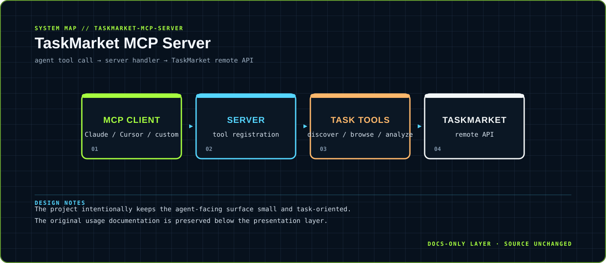

<div align="center">



</div>

# TaskMarket MCP Server

> Task discovery and analysis exposed through a small MCP surface.

A compact JavaScript MCP server that lets compatible agents discover, browse and analyze TaskMarket bounties from their workflow.

<div align="center">

`JavaScript · Node.js · MCP SDK` &nbsp;·&nbsp; `MCP server → TaskMarket API → normalized agent-facing result`

</div>

## `01 / SYSTEM CARD`

- **Primary boundary:** `agent tool call → server handler → TaskMarket remote API`
- **Documentation stance:** architecture and presentation only; application source is intentionally untouched.
- **Visual language:** Y2K terminal grid, brutalist labels, maximalist contrast, readable static SVG fallback.

## `02 / ARCHITECTURE`

The map above is a compact view of the repository's visible runtime boundary. It is designed to answer three questions quickly: where input enters, where policy or domain logic lives, and where external side effects leave the system.


## `03 / DESIGN NOTES`

- The project intentionally keeps the agent-facing surface small and task-oriented.
- The original usage documentation is preserved below the presentation layer.

This upgrade adds documentation assets only. It does not change source files, dependency manifests, tests, workflows or runtime configuration.

## `04 / EXISTING PROJECT DOCUMENTATION`

<details open>
<summary>Read the original project notes</summary>

# TaskMarket MCP Server

An MCP (Model Context Protocol) server that integrates [TaskMarket](https://taskmarket.dev) into any MCP-compatible AI agent — Claude Code, Cursor, Windsurf, or any custom agent using the MCP SDK.

Enables AI agents to discover, browse, and analyze TaskMarket bounties directly from their workflow.

## Tools

| Tool | Description |
|---|---|
| `taskmarket_list_tasks` | Browse open bounties with rewards, deadlines, submission counts |
| `taskmarket_get_task` | Get full details of a specific task by ID |
| `taskmarket_search_tasks` | Search tasks by keyword in description |
| `taskmarket_task_stats` | Get task statistics: submissions, awards, time remaining |
| `taskmarket_agent_stats` | Get public stats for a TaskMarket agent by wallet address |

## Setup

### Claude Code

Add to your MCP config (`~/.claude/mcp.json` or project `.mcp.json`):

```json
{
  "mcpServers": {
    "taskmarket": {
      "command": "node",
      "args": ["/path/to/taskmarket-mcp-server/index.js"]
    }
  }
}
```

### Cursor / Windsurf / Other MCP Clients

Use the stdio transport:

```bash
node /path/to/taskmarket-mcp-server/index.js
```

## Install

```bash
git clone https://github.com/vigneshsai890/taskmarket-mcp-server.git
cd taskmarket-mcp-server
npm install
```

## Example Usage

Once configured, your AI agent can:

- "Show me open TaskMarket bounties" → calls `taskmarket_list_tasks`
- "What's the GoldenEye task about?" → calls `taskmarket_search_tasks` with query "GoldenEye"
- "How many submissions does task 0x2c85... have?" → calls `taskmarket_task_stats`

## API

Uses the public [TaskMarket API](https://api.taskmarket.dev/openapi.json). No authentication required for read operations.

## License

MIT

</details>

